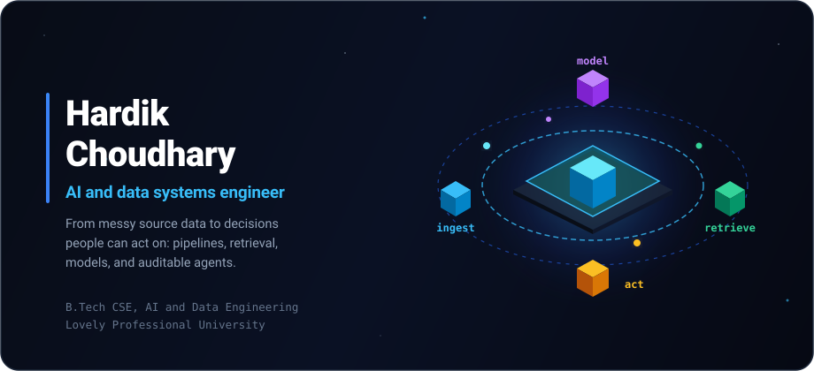
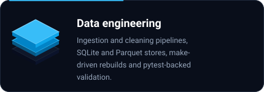
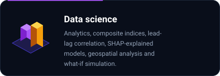
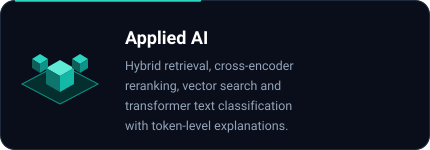
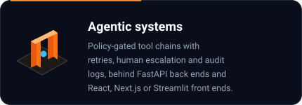
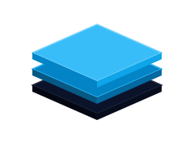
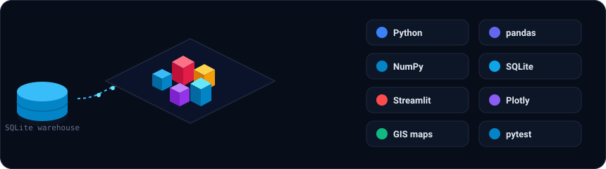
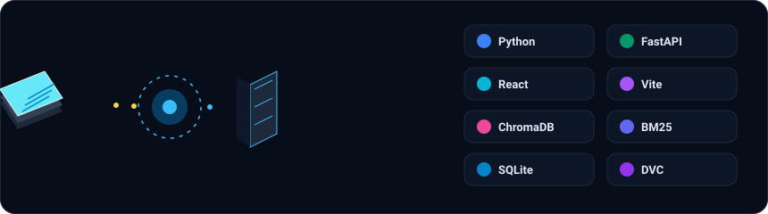
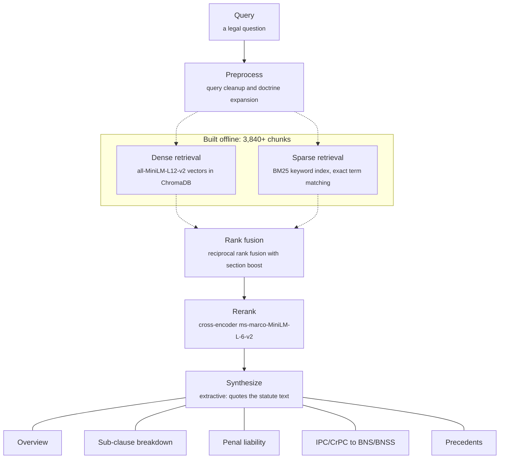
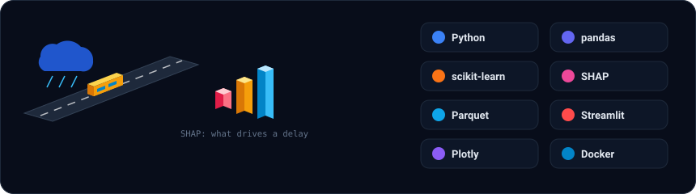

<!-- Hero Banner -->

  

<!-- Action & CV Buttons -->

  
  &nbsp;&nbsp;
  

<!-- Social & Profiles Bar -->

  &nbsp;
  &nbsp;
  &nbsp;
  &nbsp;
  &nbsp;
  

---

## About

I'm a Computer Science and Engineering student at **Lovely Professional University**, focused on **applied AI, data engineering, and analytics**. I build end-to-end projects that turn raw data into useful tools—from ingestion and analysis to retrieval or machine learning, APIs, and user interfaces. My work includes healthcare access analytics, legal document retrieval, market-news analysis, and explainable NLP. I work mainly with Python and SQL, alongside FastAPI, PyTorch, scikit-learn, React, and Streamlit.

 

<table width="100%" border="0" cellspacing="0" cellpadding="0">
  <tr>
    <td width="50%" align="center" valign="top">
      
    </td>
    <td width="50%" align="center" valign="top">
      
    </td>
  </tr>
  <tr>
    <td width="50%" align="center" valign="top">
      
    </td>
    <td width="50%" align="center" valign="top">
      
    </td>
  </tr>
</table>

---

## How the systems fit together

<table width="100%" border="0" cellspacing="0" cellpadding="8">
  <tr>
    <td width="28%" align="center" valign="middle">
      
    </td>
    <td width="72%" valign="middle">
      <h3 style="margin: 0 0 4px 0;">Ingest and shape</h3>
      
Source data into trusted tables

      <ul style="margin: 0; padding-left: 20px; color: #94A3B8;">
        <li>RSS, SEC EDGAR, FNSPID and NSE feeds, deduplicated and chunked</li>
        <li>SQLite warehouse: 640 districts and 673,638 villages</li>
        <li>Parquet feature tables joined with weather and city event data</li>
      </ul>
    </td>
  </tr>
  <tr>
    <td width="28%" align="center" valign="middle">
      
    </td>
    <td width="72%" valign="middle">
      <h3 style="margin: 0 0 4px 0;">Retrieve and ground</h3>
      
Deterministic hybrid search and vector index

      <ul style="margin: 0; padding-left: 20px; color: #94A3B8;">
        <li>Hybrid dense (ChromaDB / Qdrant) + sparse (BM25) with Reciprocal Rank Fusion</li>
        <li>Cross-encoder rerankers (ms-marco-MiniLM-L-6-v2) for high-precision retrieval</li>
        <li>Verbatim statutory & clinical citation extraction (0% hallucination)</li>
      </ul>
    </td>
  </tr>
  <tr>
    <td width="28%" align="center" valign="middle">
      
    </td>
    <td width="72%" valign="middle">
      <h3 style="margin: 0 0 4px 0;">Model and explain</h3>
      
Calibrated predictions with explainable AI

      <ul style="margin: 0; padding-left: 20px; color: #94A3B8;">
        <li>BERT + BiLSTM self-attention ensembles with token-level attention heatmaps</li>
        <li>HistGradientBoosting & Random Forest classifiers with SHAP delay drivers</li>
        <li>Lead-lag cross-correlation testing (±5 days) with p-value significance</li>
      </ul>
    </td>
  </tr>
  <tr>
    <td width="28%" align="center" valign="middle">
      
    </td>
    <td width="72%" valign="middle">
      <h3 style="margin: 0 0 4px 0;">Act and audit</h3>
      
Gated autonomous execution with human-in-the-loop

      <ul style="margin: 0; padding-left: 20px; color: #94A3B8;">
        <li>Multi-tool chained execution (≥3 tools per ticket) with @resilient_tool retries</li>
        <li>Zero-LLM deterministic rule engines + full tamper-evident audit logs</li>
        <li>Interactive dashboards & workspaces (FastAPI, React/Vite, Next.js, Streamlit)</li>
      </ul>
    </td>
  </tr>
</table>

---

## Featured systems

Six projects that show how I work across data, applied AI, analytics, and software.

### [Rural Healthcare Access Gap Mapper](https://github.com/Har-dik25/Rural-Healthcare-Access-Gap)

- Combines MoHFW, Census, NFHS-5, and travel-time data for **640 districts and 673,638 villages** in a SQLite analytical warehouse.
- Adds a composite Access Gap Index and a 12-module Streamlit dashboard with GIS maps, district drill-downs, and resource-allocation what-if analysis.
- **Status:** Decision-support prototype using public data; runs locally with documented tests.

 

### [Samvidhan AI (LegalMind)](https://github.com/Har-dik25/Samvidhan_AI)

- Implements hybrid retrieval over **3,840+ legal chunks**, combining ChromaDB dense search, BM25, reciprocal-rank fusion, and cross-encoder reranking.
- Zero-LLM extractive legal intelligence engine over the Indian legal corpus (BNS/BNSS/BSA 2023, Constitution of India, IPC/CrPC, and landmark Supreme Court precedents) delivering verbatim statutory answers (0% hallucination) in <0.02s.
- **Status:** Decision-support prototype with interactive IPC↔BNS and CrPC↔BNSS transmuters.

 

### [Algorithmic Market Sentiment & News Vector Correlation Platform](https://github.com/Har-dik25/Algorithmic-Market-Sentiment-News-Vector-Correlation-Platform)

- Ingests financial news, SEC filings, FNSPID data, and NSE feeds; cleans and indexes text in Qdrant for semantic search.
- Tests news-sentiment signals against returns with lead-lag correlation and p-values, with a HistGradientBoosting model for comparison.
- **Status:** End-to-end exploratory research pipeline; not a trading system.

 

### [TransitAI: Public Transport Delay Analyzer](https://github.com/Har-dik25/TransitAI)

- Uses a `make`-driven pipeline to join **simulated NYC MTA bus trips** with historical weather and city events, then trains delay models with SHAP explanations.
- Features a 12-KPI dashboard, "What-If" trip delay simulator, and 7-day forecast with hypothetical storm scenarios.
- **Status:** Fully reproducible ML pipeline with Makefile and automated validation.

 

### [MediNote — AI Medical Documentation & Copilot](https://github.com/Har-dik25/MediNote)

- Open-source, zero-cost AI medical copilot that listens to doctor-patient conversations and synthesizes structured SOAP notes, suggests ICD-10 codes, and flags drug interactions.
- Runs HuggingFace Whisper locally for privacy-preserving transcription, with Llama 3 via Groq, LangChain orchestration, and a local ChromaDB vector store grounded in NICE, CDC, EMA, and WHO guidelines.
- **Status:** Applied AI internship project at Futurense Technologies.

 

### [ShopWave — Autonomous Support Resolution Agent](https://github.com/Har-dik25/ShopWave_Autonomous_Support_Resolution_Agent)

- Rule-based (zero-LLM) autonomous support resolution agent for the NexusDesk e-commerce platform that processes 20 customer tickets concurrently (8 workers, ~0.13s total) using a 9-tool toolkit with chained calls (fetch → verify → act → reply).
- Classifies tickets into 8 categories with urgency detection, executes refunds/cancellations/replacements, escalates ambiguous cases, and emits a complete audit log.
- **Status:** Zero-LLM, zero-dependency pure Python 3.10+ standard library implementation.
